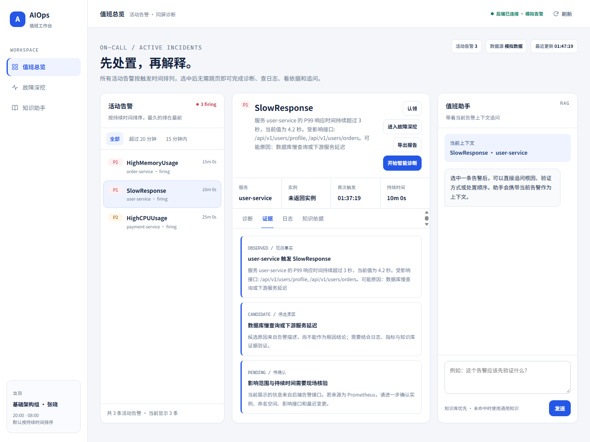
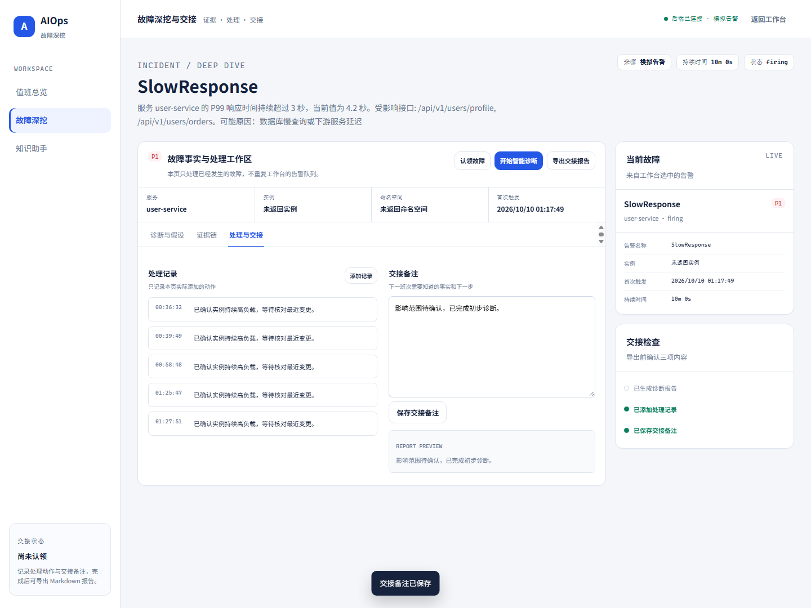
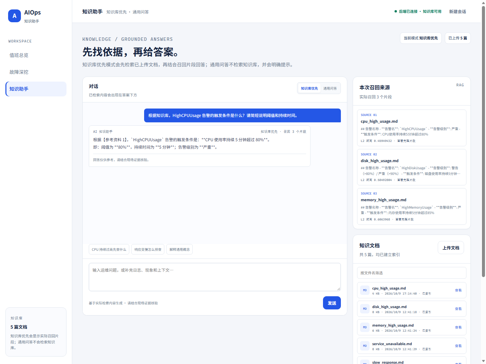
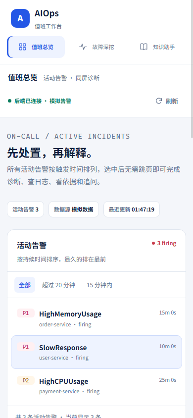
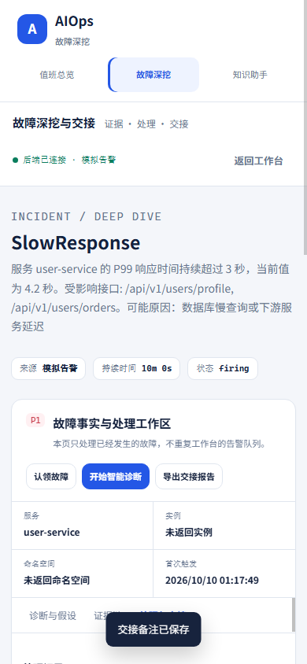
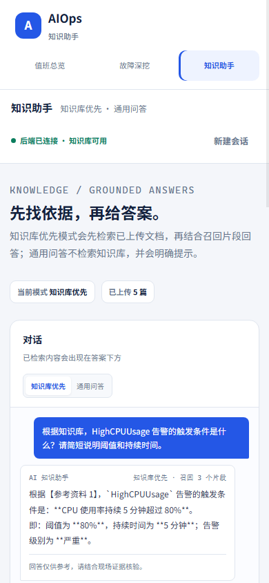

# AIOps 智能运维与知识助手平台

面向值班、故障排查与交接场景的 AIOps 工作台，把活动告警、诊断证据、处理记录和知识依据集中到同一套页面中。仓库同时提供可在 GitHub Pages 独立运行的静态演示版，以及包含 Spring Boot、Spring AI、Milvus 和 RAG 链路的本地完整版。

- 在线演示：<https://ifox-hu.github.io/superbizagent-aiops/>
- GitHub 仓库：<https://github.com/ifox-hu/superbizagent-aiops>
- 技术栈：Java 17、Spring Boot 3.2.0、Spring AI 1.1.0、Spring AI Alibaba 1.1.0.0-RC2、Milvus、原生 HTML/CSS/JavaScript
- 仓库使用 Apache-2.0 许可证
- Pages 静态版只使用浏览器内 Mock API；本地完整版才会连接模型、Milvus、Prometheus 或 CLS

> 当前实现用于值班工作台、RAG 问答、Agent 诊断和多 Agent 编排的技术实践与演示，不代表已经具备生产级自动运维能力。系统不会自动执行扩容、回滚、重启或配置变更，诊断结果只应作为排查参考。

## 1. 项目定位

AIOps 智能运维与知识助手平台围绕“先处置，再解释”的值班流程设计，将告警事实、候选原因、日志证据、知识库召回和交接记录组织在同一工作区内。项目保留两种运行形态：

1. **静态演示版**：部署在 GitHub Pages。页面通过 `docs/mock-api.js` 在浏览器内拦截 API 请求并返回演示数据，不依赖 Java、Docker、Milvus 或模型服务。
2. **本地完整版**：由 `src/main/java` 下的 Spring Boot 服务提供后端接口，支持 OpenAI 兼容聊天模型、DashScope、Ollama 向量模型、Milvus、Prometheus、腾讯云 CLS/MCP、文档上传、向量索引和 SSE 流式问答。

## 2. 在线演示、仓库地址和核心特点

| 项目 | 地址或说明 |
| --- | --- |
| GitHub Pages 在线演示 | <https://ifox-hu.github.io/superbizagent-aiops/> |
| GitHub 仓库 | <https://github.com/ifox-hu/superbizagent-aiops> |
| 静态演示入口 | `docs/index.html` |
| 完整版默认入口 | `http://localhost:9900/` |

核心特点：

- **值班总览**：按持续时间展示活动告警，支持筛选、同屏诊断、日志查询、知识依据查看和告警上下文追问。
- **故障深挖与交接**：将观测事实、候选原因、待验证项、处理记录和交接备注分开呈现，并可导出 Markdown 报告。
- **知识助手**：支持“知识库优先”和“通用问答”两种模式；知识库优先模式展示实际召回片段，通用问答不检索知识库。
- **真实 RAG 链路**：文档上传后按标题和段落切片，调用向量模型生成向量并写入 Milvus，再通过 L2 距离检索相关片段。
- **双形态部署**：Pages 静态版用于展示，Spring Boot 本地版用于联调和真实链路验证。
- **浏览器级回归**：仓库提供无头 Edge 回归脚本，覆盖静态 Mock API、完整版页面、布局溢出和诊断输出滚动。

## 3. 项目解决的问题和目标用户

| 目标用户 | 典型问题 | 项目提供的方式 |
| --- | --- | --- |
| 一线值班人员 | 告警分散在多个页面，排查时需要来回跳转 | 在值班总览中集中查看活动告警、日志、知识依据和诊断结果 |
| 二线排查人员 | 故障事实、候选原因和待验证项混在一起，难以交接 | 在故障深挖页中拆分证据、假设、处理动作和交接备注 |
| 运维知识维护者 | 文档只在目录中存在，无法在排障时快速定位 | 通过上传、切片、向量化和知识库优先问答复用文档 |
| 后端和平台开发者 | 想验证 Spring AI Agent、RAG、Milvus 和 SSE 流式链路 | 提供可运行的 Java 服务、接口和本地部署脚本 |
| 开源项目展示者 | 需要无后端也能访问的演示站点 | 使用 GitHub Pages 静态版和浏览器内 Mock API |

## 4. 主要功能

### 4.1 值班总览

- 读取活动告警，并按持续时间从长到短排序。
- 支持“全部”“超过 20 分钟”“15 分钟内”等筛选条件。
- 选中告警后，在同一工作区切换诊断、证据、日志和知识依据。
- 调用 `/api/chat_stream`，以 SSE 流式显示诊断报告。
- 带着当前告警上下文调用 `/api/platform/knowledge/stream` 追问。
- 将选中的告警带入故障深挖页面。

### 4.2 故障深挖与交接

- 展示告警来源、服务、实例、命名空间、首次触发时间和持续时间。
- 将观测事实、候选原因和待验证项分栏展示。
- 查询关联日志并读取知识库文档。
- 添加处理记录、保存交接备注并显示交接检查状态。
- 导出包含故障事实、诊断报告、知识依据、处理记录和交接备注的 Markdown 文件。

### 4.3 知识助手

**知识库优先模式**

- 先将问题向量化，再从 Milvus 检索相关片段。
- 将召回片段作为参考资料传给聊天模型。
- 如果参考资料不足或与问题无关，代码会要求模型使用通用知识补充，并在回答开头说明“知识库未命中，以下内容来自通用知识”。
- 通过 SSE 的 `sources` 事件返回实际召回片段，包括 `id`、`content`、`metadata` 和 `score`。
- `score` 是 Milvus 的 L2 距离，不是可信度、概率或相似度百分比。

**通用问答模式**

- 不调用知识库检索。
- 直接把用户问题和受限的对话历史传给聊天模型。
- 前端不展示召回来源，并提示用户自行核验事实性内容。

**文档管理**

- 完整版上传接口接受 `multipart/form-data`。
- 基础配置允许 `.txt` 和 `.md`；页面文件选择器还允许 `.markdown`。由于 `file.upload.allowed-extensions` 默认只写入了 `txt,md`，如需上传 `.markdown`，需要同步修改配置。
- 同名文件会覆盖旧文件。
- 上传成功后会执行切片、向量化并写入 Milvus；索引失败时接口返回错误。
- 静态演示版的上传接口只返回模拟成功结果，不会写入文件或向量库。

## 5. 界面预览

### 值班总览



### 故障深挖与交接



### 知识助手



### 移动端预览







## 6. 静态演示版与本地完整版的对比

| 能力 | GitHub Pages 静态版 | 本地完整版 |
| --- | --- | --- |
| 运行依赖 | 浏览器和静态文件服务器 | Java 17、Maven、Docker、Milvus、Ollama 和聊天模型 |
| 页面入口 | `docs/index.html` 及三个 `*-v2.html` 页面 | `http://localhost:9900/` 及 `/designs/*.html` |
| 告警数据 | 浏览器内 Mock 数据 | Prometheus API 或后端 Mock |
| 日志数据 | 浏览器内 Mock 数据 | CLS 工具或后端 Mock |
| 文档列表 | `mock-api.js` 中的固定文档 | 上传目录中的实际文件 |
| 文档上传 | 返回 Mock 成功结果 | 写入磁盘、切片、向量化并写入 Milvus |
| 知识问答 | 浏览器内流式 Mock 回答 | RAG 检索和聊天模型 SSE |
| 智能诊断 | 浏览器内流式 Mock 报告 | ReactAgent、SupervisorAgent、Planner 和 Executor |
| 会话保存 | 浏览器 `localStorage` / `sessionStorage` | 部分服务端内存会话或浏览器本地存储 |
| 数据边界 | 不连接真实系统 | 是否连接真实系统由配置决定 |

静态演示版适合无后端环境的展示和界面回归；本地完整版适合验证模型、向量库、Agent 工具链和上传索引流程。两者不能互相替代。

## 7. 技术架构和技术栈

### 7.1 技术栈

| 层次 | 技术 | 仓库中的版本或说明 |
| --- | --- | --- |
| 语言与运行时 | Java | 17 |
| 应用框架 | Spring Boot | 3.2.0 |
| Web | Spring MVC、Spring Boot Starter Web | 提供 REST、SSE、静态资源和文件上传 |
| AI 框架 | Spring AI | 1.1.0 |
| 阿里云 AI 扩展 | Spring AI Alibaba | 1.1.0.0-RC2 |
| 聊天模型 | OpenAI 兼容接口或 DashScope | 本地配置使用 OpenAI 兼容中转；基础配置保留 DashScope 分支 |
| Agent 框架 | Spring AI Alibaba Agent Framework | ReactAgent、SupervisorAgent、Planner 和 Executor |
| 向量模型 | Ollama `bge-m3` 或 DashScope `text-embedding-v4` | 本地配置使用 Ollama，向量维度要求 1024 |
| 向量数据库 | Milvus | Java SDK 2.6.10，collection 名称 `biz`，IVF_FLAT 和 L2 |
| Prompt 与工具 | Spring AI Tool、MCP Client WebFlux | 时间、知识库、Prometheus 告警、CLS 日志等工具 |
| 构建 | Maven | 构建产物为 `target/super-biz-agent-1.0-SNAPSHOT.jar` |
| 前端 | 原生 HTML、CSS、JavaScript、SSE | 不依赖前端构建工具 |
| 回归测试 | Node.js、无头 Edge、CDP | 仓库没有 `src/test` 下的 Maven 自动化测试 |

### 7.2 运行链路

```text
文档上传
  -> 保存到 file.upload.path
  -> 按 Markdown 标题和段落切片
  -> 调用 Ollama bge-m3 或 DashScope Embedding
  -> 写入 Milvus 的 biz collection

知识库优先问答
  -> 将问题向量化
  -> 从 Milvus 执行 L2 检索
  -> 构造参考资料 Prompt
  -> 调用聊天模型
  -> 通过 SSE 返回 sources、content 和 done

智能运维诊断
  -> SupervisorAgent 调度 Planner 和 Executor
  -> 调用告警、日志、时间和知识库工具
  -> 生成 Markdown 告警分析报告
  -> 通过 SSE 返回内容块和完成事件
```

## 8. 项目目录结构

```text
.
├── .github/workflows/pages.yml          # GitHub Pages 自动部署
├── aiops-docs/                          # 内置运维知识文档
├── deployment/                          # 本地启动、停止、Maven 配置、回归脚本和预览图
├── docs/                                # GitHub Pages 静态演示版和 Mock API
├── src/main/java/org/example/
│   ├── agent/tool/                      # 时间、知识库、告警和日志工具
│   ├── client/                          # Milvus 客户端工厂
│   ├── config/                          # Web、文件上传、文档切片和 Milvus 配置
│   ├── constant/                        # Milvus collection 和向量维度常量
│   ├── controller/                      # REST 和 SSE 控制器
│   ├── dto/                             # 数据传输对象
│   ├── service/                         # Chat、RAG、Agent、向量索引和检索服务
│   └── tool/                            # 独立运维脚本类
├── src/main/resources/
│   ├── application.yml                  # 默认后端配置
│   └── static/                          # 完整版前端页面
├── LICENSE                              # Apache-2.0 许可证
├── Makefile                             # Unix 和 Make 环境下的启动、停止、上传及容器命令
├── pom.xml                              # Maven 构建配置
└── vector-database.yml                  # 通用 Milvus Docker Compose 配置
```

## 9. 环境要求和前置依赖

### 9.1 静态演示版

- 现代浏览器。
- 任选一种静态文件服务器：Node.js、Python 或编辑器自带静态服务器。
- 不需要 Java、Maven、Docker、Milvus、模型密钥或后端服务。

### 9.2 本地完整版

| 依赖 | 用途 | 说明 |
| --- | --- | --- |
| JDK 17 | 编译和运行 Spring Boot | `pom.xml` 指定 Java 17 |
| Maven | 构建和运行 | 仓库未提供 Maven Wrapper |
| Docker Desktop | 运行 Milvus、etcd、MinIO 和 Attu | PowerShell 脚本使用 `docker compose` |
| Ollama | 提供本地 `bge-m3` 向量服务 | `deployment/start-local.ps1` 实际会调用 `deployment/start-embedding.ps1` |
| OpenAI 兼容中转或 DashScope | 提供聊天模型 | 本地配置使用 `RELAY_API_KEY`；基础配置保留 `DASHSCOPE_API_KEY` |
| Node.js 和无头 Edge | 运行浏览器回归脚本 | 仅在执行 `deployment/*.cjs` 时需要 |

当前 Windows 启动脚本包含本机绝对路径和特定工具目录，例如 Ollama 可执行文件、模型目录、Maven 本地仓库和数据目录。因此它不是一个完全通用的跨平台安装器。迁移到其他机器前，应先检查并修改 `deployment/start-local.ps1`、`deployment/start-embedding.ps1` 和 `deployment/maven-settings.xml` 中的本机路径。

## 10. 环境变量与模型、Milvus、日志和监控配置

### 10.1 环境变量

| 变量 | 是否必需 | 用途 |
| --- | --- | --- |
| `RELAY_API_KEY` | 本地 OpenAI 兼容中转模式必需 | `deployment/application-local.yml` 中的 `relay.api-key` |
| `DASHSCOPE_API_KEY` | 使用 DashScope 分支时必需 | `application.yml` 中的 `spring.ai.dashscope.api-key` 和 `dashscope.api.key` |

不要把真实密钥、Token、内部地址或生产数据写入仓库。`deployment/start-local.ps1` 按以下顺序读取中转密钥：

1. 当前 PowerShell 会话中的 `RELAY_API_KEY`。
2. Windows 用户级环境变量 `RELAY_API_KEY`。
3. 本机加密密钥文件。文件名和路径以脚本中的本机配置为准，不要提交该文件。

### 10.2 默认配置与服务端口

| 配置项 | 默认值 | 来源 |
| --- | --- | --- |
| 服务端口 | `9900` | `src/main/resources/application.yml` |
| 上传目录 | `./uploads` | `src/main/resources/application.yml` |
| 允许扩展名 | `txt,md` | `src/main/resources/application.yml` |
| Milvus 地址 | `localhost:19530` | `src/main/resources/application.yml` |
| Milvus 数据库 | `default` | `src/main/resources/application.yml` |
| Milvus 超时 | `10000ms` | `src/main/resources/application.yml` |
| collection | `biz` | `MilvusConstants` |
| 向量维度 | `1024` | `MilvusConstants` |
| 索引与距离 | `IVF_FLAT`、`L2` | `MilvusClientFactory` |
| 文档切片最大长度 | `800` | `document.chunk.max-size` |
| 文档切片重叠长度 | `100` | `document.chunk.overlap` |
| RAG Top-K | `3` | `rag.top-k` |
| 默认 RAG 模型名 | `qwen3-max` | `rag.model`，DashScope 分支 |
| DashScope 请求超时 | `180000ms` | `spring.ai.dashscope.chat.options.timeout` |
| DashScope 重试 | 最多 3 次 | `spring.ai.dashscope.retry.max-attempts` |
| Prometheus 地址 | `http://localhost:9090` | `prometheus.base-url` |
| Prometheus 超时 | `10s` | `prometheus.timeout` |
| Prometheus Mock | `false` | `prometheus.mock-enabled` |
| CLS Mock | `false` | `cls.mock-enabled` |

### 10.3 本地配置覆盖

`deployment/application-local.yml` 会覆盖默认配置：

| 配置项 | 本地值 | 说明 |
| --- | --- | --- |
| 绑定地址 | `127.0.0.1` | 只监听本机 |
| AI Provider | `openai` | 使用 OpenAI 兼容接口 |
| 中转模型 | `deepseek-flash` | 通过 `relay.model` 配置 |
| 推理强度 | `low` | `relay.reasoning-effort` |
| 中转地址 | 在配置文件中配置 OpenAI 兼容端点 | README 不记录内部或私有端点 |
| 向量化 Provider | `ollama` | 本地向量化 |
| 向量服务 | `http://127.0.0.1:11435` | 由 `start-embedding.ps1` 启动 |
| 向量模型 | `bge-m3` | 维度必须为 1024 |
| MCP Client | `false` | 本地演示关闭远程 MCP |
| Prometheus Mock | `true` | 使用后端模拟告警 |
| CLS Mock | `true` | 使用后端模拟日志 |
| 上传目录 | Windows 专用绝对路径 | 迁移时需要修改 |

### 10.4 MCP 与真实监控

基础 `application.yml` 中启用了名为 `tencent-mcp-server` 的 MCP Client，并预留了腾讯云 CLS SSE 连接配置。仓库中的 SSE endpoint 是占位形式，不应在 README 中写入真实地址或令牌。

如果要接入真实 Prometheus 或 CLS：

1. 关闭对应的 Mock 配置。
2. 在本地覆盖配置或环境变量中填入真实地址和认证信息。
3. 不要提交密钥、Token、内部域名或生产数据。
4. 在接入真实工具前，不要把当前演示结果表述为真实生产监控结果。

## 11. 静态版本地预览步骤

在仓库根目录任选一种方式启动静态服务器。

### Node.js

```powershell
npx --yes serve docs
```

### Python

```powershell
python -m http.server 8080 -d docs
```

然后打开：

- `http://localhost:3000/`
- 或 `http://localhost:8080/`

建议使用静态服务器而不是直接双击 HTML，以便正确处理相对路径和浏览器内流式响应。

## 12. 完整版 Windows PowerShell 一键启动步骤

### 12.1 设置中转密钥

```powershell
$env:RELAY_API_KEY = '<your-api-key>'
```

不要将真实密钥写入 README、YAML、Java 文件或 Git 提交。

### 12.2 一键启动

```powershell
# 在克隆后的仓库根目录执行
powershell -ExecutionPolicy Bypass -File .\deployment\start-local.ps1
```

脚本执行顺序：

1. 使用 `docker compose -p superbizagent -f deployment/compose.local.yml up -d --wait` 启动 etcd、MinIO、Milvus 和 Attu。
2. 读取 `RELAY_API_KEY`。
3. 启动 Ollama 的 `bge-m3` 向量服务；本地不存在模型时会尝试下载。
4. 如果 JAR 不存在或传入 `-Build`，执行 Maven 打包。
5. 以 Java 17 启动 `target/super-biz-agent-1.0-SNAPSHOT.jar`。
6. 轮询 `http://127.0.0.1:9900/milvus/health`，成功后输出访问地址。

### 12.3 常用启动参数

```powershell
# 重新构建后启动
powershell -ExecutionPolicy Bypass -File .\deployment\start-local.ps1 -Build

# 只启动 Milvus、etcd、MinIO 和 Attu
powershell -ExecutionPolicy Bypass -File .\deployment\start-local.ps1 -DatabaseOnly

# 停止本项目 Java、数据库容器和向量服务，保留模型和数据
powershell -ExecutionPolicy Bypass -File .\deployment\stop-local.ps1
```

### 12.4 启动后访问

| 服务 | 地址 |
| --- | --- |
| 完整版首页 | <http://localhost:9900/> |
| 值班总览 | <http://localhost:9900/designs/workbench-v2.html> |
| 故障深挖 | <http://localhost:9900/designs/incident-v2.html> |
| 知识助手 | <http://localhost:9900/designs/knowledge-v2.html> |
| Milvus 健康检查 | <http://127.0.0.1:9900/milvus/health> |
| Attu | <http://localhost:8000> |
| MinIO Console | <http://localhost:9001> |

## 13. 构建、停止、日志查看和常用命令

### 13.1 Maven 构建

```powershell
mvn -s .\deployment\maven-settings.xml -B -ntp package
```

构建产物：

```text
target/super-biz-agent-1.0-SNAPSHOT.jar
```

如果使用系统默认 Maven 配置且不需要仓库内镜像设置，也可以执行：

```powershell
mvn -B -ntp package
```

### 13.2 停止和查看日志

```powershell
# 停止项目
powershell -ExecutionPolicy Bypass -File .\deployment\stop-local.ps1

# 查看应用标准输出
Get-Content .\deployment\app.stdout.log -Wait

# 查看应用错误输出
Get-Content .\deployment\app.stderr.log -Wait

# 查看容器状态
docker compose -p superbizagent -f .\deployment\compose.local.yml ps
```

### 13.3 Makefile 命令

Makefile 面向 Unix shell，使用 `nohup`、`curl`、`pkill` 和 `docker-compose`。在 Windows PowerShell 中不能直接执行这些目标；请优先使用 PowerShell 脚本。

```bash
make init       # 启动 Docker、启动 Spring Boot、等待健康检查、上传 aiops-docs
make up         # 启动 vector-database.yml 中的 Milvus 容器
make down       # 停止 Milvus 容器
make status     # 查看 Milvus 容器状态
make start      # 后台启动 Spring Boot
make stop       # 停止 Spring Boot
make restart    # 重启 Spring Boot
make check      # 检查服务健康状态
make wait       # 等待服务就绪
make upload     # 上传 aiops-docs/*.md
make clean      # 清理 server.pid、server.log 和临时文件
make list-docs  # 列出知识文档
make test-upload # 上传单个测试文档
```

### 13.4 可选 Docker 场景

通用 Milvus Compose 文件是 `vector-database.yml`，本地完整版脚本使用的是 `deployment/compose.local.yml`：

```powershell
# 通用容器
docker compose -f .\vector-database.yml up -d
docker compose -f .\vector-database.yml down

# 本地完整版容器
docker compose -p superbizagent -f .\deployment\compose.local.yml up -d
docker compose -p superbizagent -f .\deployment\compose.local.yml down
```

## 14. 主要 API 或 Mock API 一览

### 14.1 真实后端 API

| 接口 | 方法 | 说明 |
| --- | --- | --- |
| `/api/chat` | POST | ReactAgent 普通对话，请求体使用 `Id` 和 `Question`，最多保留 6 对内存会话历史 |
| `/api/chat/clear` | POST | 清空指定 `Id` 的内存会话 |
| `/api/chat/session/{sessionId}` | GET | 查询会话消息对数量和创建时间 |
| `/api/chat_stream` | POST | ReactAgent SSE 流式对话，5 分钟超时 |
| `/api/ai_ops` | POST | SupervisorAgent 自动告警分析，SSE 流式返回，10 分钟超时 |
| `/api/platform/alerts` | GET | 返回 Prometheus 或 Mock 活动告警，并带 `mock` 标记 |
| `/api/platform/logs` | GET | 查询日志，支持 `topic` 和 `query` 参数 |
| `/api/platform/documents` | GET | 返回上传目录中的文档列表 |
| `/api/platform/documents/content` | GET | 按文件名读取文档内容 |
| `/api/platform/knowledge/stream` | POST | 知识库优先或通用问答，SSE 返回 `sources`、`content`、`done` 或 `error` |
| `/api/upload` | POST | 上传 `txt` 或 `md`（基础配置）并执行切片、向量化和 Milvus 写入 |
| `/milvus/health` | GET | 返回 Milvus collection 列表；失败时返回 503 |

SSE 事件示例：

```json
{"type":"content","data":"正在分析告警..."}
{"type":"sources","data":[{"id":"...","content":"...","metadata":"...","score":0.18}]}
{"type":"done","data":""}
```

`score` 是 Milvus L2 距离，不是可信度、概率或相似度百分比。

### 14.2 浏览器 Mock API

`docs/mock-api.js` 只拦截路径中包含 `/api/` 的 `fetch` 请求：

| Mock 接口 | 方法 | 返回内容 |
| --- | --- | --- |
| `/api/platform/alerts` | GET | `HighCPUUsage`、`SlowResponse`、`HighMemoryUsage` 三条演示告警 |
| `/api/platform/documents` | GET | 五份固定文档的名称、大小和更新时间 |
| `/api/platform/documents/content` | GET | 指定演示文档的内容 |
| `/api/platform/logs` | GET | 按主题返回三条演示日志 |
| `/api/upload` | POST | 返回 Mock 上传成功结果 |
| `/api/platform/knowledge/stream` | POST | 流式返回 Mock 来源和问答内容 |
| `/api/chat_stream` | POST | 流式返回 Mock 诊断报告 |

静态 Mock **没有实现**以下真实后端接口，调用时会返回 `404`：

- `/api/chat`
- `/api/chat/clear`
- `/api/chat/session/{sessionId}`
- `/api/ai_ops`
- `/milvus/health`

### 14.3 内置知识文档

`aiops-docs/` 当前包含：

- `cpu_high_usage.md`
- `disk_high_usage.md`
- `memory_high_usage.md`
- `service_unavailable.md`
- `slow_response.md`

这些文档用于本地知识库演示和 `make upload`。文档内的联系方式、参考路径和处置命令属于示例内容，不应直接用于生产环境。

## 15. 测试与浏览器回归方式

### 15.1 项目自带的自动化情况

仓库当前没有 `src/test`，也没有 Maven 自动化测试。已验证的自动化主要集中在 `deployment/` 下的浏览器级回归脚本。

### 15.2 静态 Pages 回归

该脚本启动临时静态服务器，使用无头 Edge 检查入口页、Mock 告警、日志、诊断流、知识库优先问答和通用问答：

```powershell
node .\deployment\check-pages-static.cjs
```

### 15.3 JavaScript 语法检查

```powershell
node --check .\docs\mock-api.js
node --check .\docs\workbench-v2.js
node --check .\docs\incident-v2.js
node --check .\docs\knowledge-v2.js
```

### 15.4 完整版页面回归

完整版运行在 `http://localhost:9900` 时执行：

```powershell
node .\deployment\check-v2-suite.cjs
node .\deployment\check-v2-knowledge-general.cjs
node .\deployment\check-diagnosis-scroll.cjs
```

这些脚本要求本机安装 Microsoft Edge，并依赖脚本中固定的 Edge 路径或本地配置。不同机器上可能需要调整 `EDGE_PATH` 或脚本内的浏览器路径。

### 15.5 手工验证建议

1. 打开值班总览，确认告警列表、持续时间排序和筛选正常。
2. 切换诊断、证据、日志和知识依据页签，确认布局不随流式内容增长而抖动。
3. 运行智能诊断，确认长报告在固定区域内滚动。
4. 在知识助手中分别测试知识库优先和通用问答。
5. 上传一份 `.md` 文档，确认文件名出现在列表中，并可读取内容。
6. 检查 `/milvus/health`，确认返回的 collection 列表符合预期。

## 16. GitHub Pages 部署方式

仓库使用 GitHub Actions 部署静态站点，工作流文件为 `.github/workflows/pages.yml`：

1. 推送到 `main` 分支，或手动触发 `Deploy GitHub Pages` 工作流。
2. 工作流检出仓库。
3. 使用 `actions/configure-pages@v5` 配置 Pages。
4. 将 `docs/` 目录作为 Pages artifact 上传。
5. 使用 `actions/deploy-pages@v4` 发布。

首次启用时，在 GitHub 仓库的 `Settings > Pages` 中将 Source 设为 **GitHub Actions**。后续每次推送到 `main` 都会自动重新部署。

静态站点只读取 `docs/` 下的 HTML、CSS、JavaScript 和 Mock API，不会执行 Java 后端、Docker 或模型请求。

## 17. 安全、数据边界和已知限制

### 17.1 安全要求

- 不要提交 `RELAY_API_KEY`、`DASHSCOPE_API_KEY`、GitHub Token、云服务 Token、Cookie 或任何真实密钥。
- 不要把生产日志、数据库导出、内部域名、内网 IP、客户数据或个人信息写入仓库。
- `deployment/application-local.yml` 只保留环境变量占位符；本机加密密钥文件不应提交。
- GitHub Pages 静态版的告警、日志、文档、上传和问答均为 Mock，不连接真实系统。
- 完整版是否连接真实系统由配置决定；在未配置真实 Prometheus、CLS 和认证信息前，不应把演示结果当作生产结果。

### 17.2 已知限制

- 项目不是生产级自动运维系统，不会自动扩容、回滚、重启或修改配置。
- 基础配置默认使用 DashScope 分支，本地配置改为 OpenAI 兼容中转；两者不能仅凭项目名称判断。
- 本地一键脚本不是通用跨平台安装器，包含 Windows 专用路径和 Ollama 可执行文件等前置条件。
- Makefile 使用 Unix shell 和 `docker-compose`，PowerShell 脚本使用 `docker compose`，两套命令不能完全互换。
- 上传接口的基础允许扩展名是 `txt,md`；页面允许选择 `.markdown`，两者存在配置差异。
- 知识库召回 `score` 是 L2 距离，不代表答案可信度。
- 知识库优先模式在资料不足时会回退到通用知识，并在提示词中要求标注来源；最终回答仍需要人工核验。
- `/api/ai_ops` 和 `/api/chat_stream` 可能运行数分钟，前端需要处理长连接、超时和取消。
- 前端完整版页面中的部分 API 地址和本地端口按本机部署场景编写；迁移到远程域名时需要调整。
- 仓库没有 `src/test`，Maven 构建通过不代表业务逻辑已有单元测试覆盖。

## 18. 许可证和开发说明

- 本项目采用 AI 辅助开发。
- 仓库使用 Apache-2.0 许可证，许可证全文见 [LICENSE](LICENSE)。
- 仓库当前可确认的远程地址为 <https://github.com/ifox-hu/superbizagent-aiops>。
- 代码中保留了若干与 SuperBizAgent、DashScope、Milvus 和 Spring AI Alibaba 相关的类名、配置名或注释，这些名称用于兼容现有代码和配置。除 Apache-2.0 许可证外，其他来源与版权归属如需对外声明：**待确认**。
- 本项目不声称已达到生产级自动运维能力，也不声称能够替代人工应急、变更审批、监控平台或工单系统。

## 贡献与反馈

欢迎通过 GitHub Issues 提交问题、改进建议和文档修正。提交代码时请：

1. 不要提交密钥、Token、内部地址、生产数据或个人敏感信息。
2. 修改配置或接口时同步更新 README 和相关部署说明。
3. 运行与改动相关的静态回归或完整版浏览器回归。
4. 如果新增真实系统集成，请在文档中明确其数据边界、认证方式和使用风险。